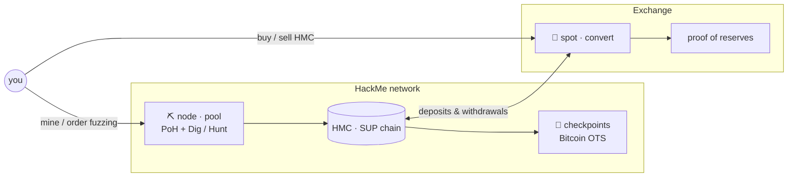

<!--
  GitHub profile README — https://github.com/jokeez
-->

<div align="center">

<pre aria-label="HackMe Network">
██╗  ██╗ █████╗  █████╗ ██╗  ██╗███╗   ███╗███████╗
██║  ██║██╔══██╗██╔════╝██║ ██╔╝████╗ ████║██╔════╝
███████║███████║██║     █████╔╝ ██╔████╔██║█████╗  
██╔══██║██╔══██║██║     ██╔═██╗ ██║╚██╔╝██║██╔══╝  
██║  ██║██║  ██║╚██████╗██║  ██╗██║ ╚═╝ ██║███████╗
╚═╝  ╚═╝╚═╝  ╚═╝ ╚═════╝╚═╝  ╚═╝╚═╝     ╚═╝╚══════╝
</pre>

### Your computer mines HMC by finding real security bugs.

Proof-of-Hash blocks + coverage-guided fuzzing of open-source code — one network, one wallet.<br/>
Hub: **[hackme.tech](https://hackme.tech)** · Exchange: **[exchange.hackme.tech](https://exchange.hackme.tech)**

<br/>

[](https://github.com/jokeez/hackme/releases/latest) [](https://explorer.hackme.tech) [](https://hackme.tech/downloads.html) [](https://github.com/jokeez/hackme/blob/main/docs/RFC_ECONOMICS_V2.md)

[](https://exchange.hackme.tech) [](https://exchange.hackme.tech/info/reserves.html) [](https://github.com/jokeez/hackme-checkpoints) [](https://github.com/jokeez/hackme) [](https://t.me/hackme_tech) [](https://www.youtube.com/@HackmeTech)

<br/>

<a href="https://www.youtube.com/watch?v=KdRr6zK2QVE">
  
</a>

<sub>**[▶ Watch the walkthrough](https://www.youtube.com/watch?v=KdRr6zK2QVE)** — what the network is and how to start mining</sub>

</div>

---

## ⏳ Economics v2 — block 550,000 (≈ Nov 15, 2026)

The schedule is compiled into **0.1.0-rc19**: every updated node switches at the same height on its own.

| | Before | **From block 550,000** |
|---|---|---|
| Block reward | 0.01 HMC | **0.1 HMC** — halving every ~4 years from genesis, then a permanent **0.002** tail |
| SUP | — | **0.002 SUP / block**, hard cap **21,000** |
| Fuzzing orders | — | **10% upfront: 5% burned 🔥 + 5% platform** · Dig & Hunt open immediately |
| Addresses | `HMC-` + 16 hex | **+ `HMC-` + 64 hex** (full key hash) — old addresses keep working, no forced migration |
| Network id | — | transfers signed for **`hackme-mainnet-1`** |

> **Running a node or miner?** Update to **rc19** and start the app once before the fork — older versions stop following the chain at 550,000.
> Full spec: **[RFC Economics v2](https://github.com/jokeez/hackme/blob/main/docs/RFC_ECONOMICS_V2.md)**

---

## Ecosystem

| | What it is | Status | Code |
|---|---|---|---|
| ⛏ **Core node + pool** | PoH blocks (Blake3), share-PPS pool, **Dig** / **Hunt** fuzzing rails with on-chain escrow, Windows · Linux · deb · rpm · Arch · HackMe OS · Docker | **Live · rc19** | [jokeez/hackme](https://github.com/jokeez/hackme) |
| 💱 **HackMe Exchange** | Spot HMC · SUP · USDT (BEP-20), convert, deposits & withdrawals, 2FA, public proof of reserves | **Live · early access** | [jokeez/hackme-exchange](https://github.com/jokeez/hackme-exchange) |
| 🧾 **Checkpoints** | Signed daily chain checkpoints anchored in Bitcoin via OpenTimestamps — verify history yourself | **Live** | [jokeez/hackme-checkpoints](https://github.com/jokeez/hackme-checkpoints) |
| 🗂 **Useful PoW Index** | Curated registry of projects where hashrate does real work | **Live** | [jokeez/hackme-app](https://github.com/jokeez/hackme-app) |
| 🔐 **HMS** | Encrypted storage / seal lane | **Preview** | in [hackme](https://github.com/jokeez/hackme) · [roadmap](https://hackme.tech/roadmap.html) |



---

## How the work is paid

| Rail | What it does | Customer pays | What a result means |
|---|---|---|---|
| **PoH** | Blake3 proof-of-hash blocks | — (block reward) | secures the chain |
| **Dig** | WASM detector / property depth across the pool | escrow · smoke 20/80 · deep 40/60 | crash-class gate; detector hits are coverage signals, not CVEs |
| **Hunt** | Coverage-guided ASAN fuzzing (libFuzzer fleet, AFL++ when present) | Lite 20 · Standard 60 · Heavy 150+ HMC | CLEAN = no qualifying native crash within budget — not an OSS-Fuzz replacement |

Teams order campaigns from their node or the **HackMe Orders** profile (no mining needed) — [fuzz guide](https://hackme.tech/fuzz-guide.html).

---

## Road to 1.0

```
 Nov 15            Nov 15–21            Nov 22–27                    Dec
 ──●─────────────────●────────────────────●─────────────────────────●──▶
 Economics v2      watch week            audits by zone + rc20        1.0 stable
 (block 550,000)   daily reconciliation  wallet login on exchange,    node + exchange
                                         long addresses by default
```

1.0 ships when it is ready, not on a date: no open critical findings, a clean week after the fork, and the exchange fully covered by on-chain reserves.

---

## Quick links

**Get started** · [Downloads](https://hackme.tech/downloads.html) · [Fuzz guide](https://hackme.tech/fuzz-guide.html) · [Developers](https://hackme.tech/developers.html)<br/>
**Exchange** · [Trade](https://exchange.hackme.tech) · [How to buy HMC](https://exchange.hackme.tech/info/buy.html) · [Proof of reserves](https://exchange.hackme.tech/info/reserves.html)<br/>
**Verify** · [Explorer](https://explorer.hackme.tech) · [Checkpoints](https://github.com/jokeez/hackme-checkpoints) · [Release checksums](https://github.com/jokeez/hackme/releases/latest)<br/>
**Read** · [News](https://hackme.tech/news.html) · [Research](https://hackme.tech/research.html) · [Roadmap](https://hackme.tech/roadmap.html) · [Economics v2 RFC](https://github.com/jokeez/hackme/blob/main/docs/RFC_ECONOMICS_V2.md)<br/>
**Talk** · [Telegram](https://t.me/hackme_tech) · [YouTube](https://www.youtube.com/@HackmeTech) · [Bitcointalk ANN](https://bitcointalk.org/index.php?topic=5583373.0)

<div align="center">

<br/>

<sub>Not financial advice · Official hub: <a href="https://hackme.tech">hackme.tech</a> only · verify checksums before you install</sub>

</div>
