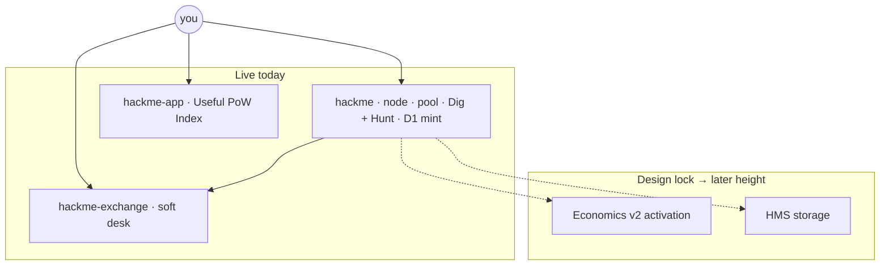

<!--
  GitHub profile README — https://github.com/jokeez
-->

<pre aria-label="HackMe Network">
██╗  ██╗ █████╗  █████╗ ██╗  ██╗███╗   ███╗███████╗
██║  ██║██╔══██╗██╔════╝██║ ██╔╝████╗ ████║██╔════╝
███████║███████║██║     █████╔╝ ██╔████╔██║█████╗  
██╔══██║██╔══██║██║     ██╔═██╗ ██║╚██╔╝██║██╔══╝  
██║  ██║██║  ██║╚██████╗██║  ██╗██║ ╚═╝ ██║███████╗
╚═╝  ╚═╝╚═╝  ╚═╝ ╚═════╝╚═╝  ╚═╝╚═╝     ╚═╝╚══════╝
</pre>

# Building the [HackMe](https://hackme.tech) ecosystem

Open network where **hashrate does useful work** — mine, settle on-chain, discover useful-PoW projects, and ship security campaigns. Hub: **[hackme.tech](https://hackme.tech)**

 

 

 

**[▶ Watch the walkthrough](https://www.youtube.com/watch?v=KdRr6zK2QVE)** — what the network is and how to get started

---

## Ecosystem map

| Piece | What it is | Status | Code |
|-------|------------|--------|------|
| **Core node + pool** | Useful PoW · Blake3 share-PPS · **Dig** / **Hunt** · escrow · installers · **D1** empty-find → settlement mint | **Live** (rc18) | [jokeez/hackme](https://github.com/jokeez/hackme) |
| **HackMe Exchange** | Early-access desk for **HMC / SUP** (matching + custody rails) | **Live** (soft desk · not a CEX listing) | [jokeez/hackme-exchange](https://github.com/jokeez/hackme-exchange) |
| **Useful PoW Index** | Curated registry of projects where hashrate does real work | **Live** | [jokeez/hackme-app](https://github.com/jokeez/hackme-app) |
| **HMS** | Encrypted storage / seal lane | **Preview** | in [hackme](https://github.com/jokeez/hackme) · [roadmap](https://hackme.tech/roadmap.html) |
| **Economics v2** | 0.1 HMC/block · ~4y halvings · pool from emission · tip+≥14d activation | **Soft announce** (not height-activated) | [RFC](https://github.com/jokeez/hackme/blob/main/docs/RFC_ECONOMICS_V2.md) |

---

## Security rails (short)

| Rail | What customers buy | Escrow | Evidence |
|------|--------------------|--------|----------|
| **Dig** | WASM detector / property depth on the pool | smoke **20/80** · deep **40/60** | Crash-class gate · detector hits = coverage noise, not CVE |
| **Hunt** | Coverage-guided ASAN (libFuzzer fleet · AFL++ when present) | **50/50** · Lite **20** · Standard **60** · Heavy **150+** HMC | CLEAN = no qualifying native crash in budget — not an OSS-Fuzz replacement |

Customers place Dig/Hunt on their node (`POST /api/security-audit`, `POST /api/hunt/campaigns`) with `pool_distributed: true` so hybrid workers claim shards. Detail: **[hackme README](https://github.com/jokeez/hackme)** · [fuzz guide](https://hackme.tech/fuzz-guide.html).

---

## Repositories

<table>
<tr>
<td width="33%" valign="top">

### [hackme](https://github.com/jokeez/hackme)
**Network core**

Public HTTP pool, Windows/Linux/deb/ISO, Dig & Hunt rails, research reports, Economics v2 RFC.

[Downloads →](https://hackme.tech/downloads.html)

</td>
<td width="33%" valign="top">

### [hackme-exchange](https://github.com/jokeez/hackme-exchange)
**Exchange desk**

Early-access HMC/SUP desk. Live site: [exchange.hackme.tech](https://exchange.hackme.tech)

</td>
<td width="33%" valign="top">

### [hackme-app](https://github.com/jokeez/hackme-app)
**Useful PoW Index**

Discover & list projects where mining does real work — free curated registry.

</td>
</tr>
</table>

Product detail lives in **[hackme README](https://github.com/jokeez/hackme)** — this profile is the ecosystem map, not a second copy of core docs.

---

## Now → next

| Now (rc18) | Next |
|------------|------|
| Public pool · Blake3 share-PPS · Dig/Hunt escrow | Economics **v2 height switch** after soak + ≥14d notice |
| **D1** empty finds mint into settlement float | Keep settlement solvent without treasury bridge |
| Soft desk at exchange.hackme.tech | Matching / listing only after security bar |
| Research ledgers (Hunt Watch, OSS CVE, Bitcoin30) | Keep publishing evidence, not hype |
| Useful PoW Index | More listed useful-work projects |
| HMS preview | Deeper storage lane when ready |

---

## Quick links

[hackme.tech](https://hackme.tech) ·
[Downloads](https://hackme.tech/downloads.html) ·
[News](https://hackme.tech/news.html) ·
[Economics v2 RFC](https://github.com/jokeez/hackme/blob/main/docs/RFC_ECONOMICS_V2.md) ·
[Exchange](https://exchange.hackme.tech) ·
[Developers](https://hackme.tech/developers.html) ·
[Research](https://hackme.tech/research.html) ·
[Telegram](https://t.me/hackme_tech) ·
[YouTube](https://www.youtube.com/watch?v=KdRr6zK2QVE) ·
[Bitcointalk ANN](https://bitcointalk.org/index.php?topic=5583373.0)

 

Not financial advice · Official hub: <a href="https://hackme.tech">hackme.tech</a> only · verify checksums before install

