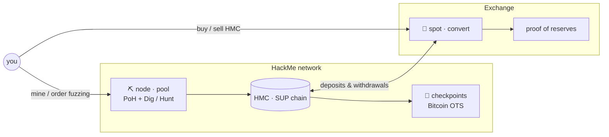

<!--
  GitHub profile README — https://github.com/jokeez
-->

<div align="center">

<pre aria-label="HackMe Network">
██╗  ██╗ █████╗  █████╗ ██╗  ██╗███╗   ███╗███████╗
██║  ██║██╔══██╗██╔════╝██║ ██╔╝████╗ ████║██╔════╝
███████║███████║██║     █████╔╝ ██╔████╔██║█████╗  
██╔══██║██╔══██║██║     ██╔═██╗ ██║╚██╔╝██║██╔══╝  
██║  ██║██║  ██║╚██████╗██║  ██╗██║ ╚═╝ ██║███████╗
╚═╝  ╚═╝╚═╝  ╚═╝ ╚═════╝╚═╝  ╚═╝╚═╝     ╚═╝╚══════╝
</pre>

### Your computer mines HMC by finding real security bugs.

Proof-of-Hash blocks + coverage-guided fuzzing on one network, one wallet.<br/>
Hub: **[hackme.tech](https://hackme.tech)** · Exchange: **[exchange.hackme.tech](https://exchange.hackme.tech)** · Channel: **[0.1.0-rc20](https://github.com/jokeez/hackme/releases/tag/0.1.0-rc20)**

<br/>

[](https://github.com/jokeez/hackme/releases/tag/0.1.0-rc20) [](https://explorer.hackme.tech) [](https://hackme.tech/downloads.html) [](https://github.com/jokeez/hackme/blob/main/docs/RFC_ECONOMICS_V2.md)

[](https://exchange.hackme.tech) [](https://exchange.hackme.tech/info/reserves.html) [](https://github.com/jokeez/hackme-checkpoints) [](https://github.com/jokeez/hackme) [](https://t.me/hackme_tech) [](https://www.youtube.com/@HackmeTech)

<br/>

<a href="https://www.youtube.com/watch?v=KdRr6zK2QVE">
  
</a>

<sub>**[▶ Watch the walkthrough](https://www.youtube.com/watch?v=KdRr6zK2QVE)** — what the network is and how to start mining</sub>

</div>

---

## Live now · 0.1.0-rc20

**HackMe** is a useful-work PoW network: miners earn **HMC** for Blake3 Proof-of-Hash and for running **Dig** / **Hunt** security campaigns. Customers pay HMC; unused escrow returns to prepaid.

| | |
|---|---|
| **Channel** | [`0.1.0-rc20`](https://github.com/jokeez/hackme/releases/tag/0.1.0-rc20) — Win Setup · Linux tar · deb · rpm · Arch · HackMe OS ISO · fuzzing CLI |
| **Downloads** | [hackme.tech/downloads.html](https://hackme.tech/downloads.html) — verify `SHA256SUMS` before install |
| **Paid Dig/Hunt** | Orders **Fund → hub prepaid escrow → public pool miners**; dashboards read hub `report` / `gate` / `pulse` (no empty local mirror) |
| **Economics v2** | **Live since block 550,000** — 0.1 HMC/block · ~4y halvings · 0.002 tail · 5% burn + 5% platform on orders · SUP 0.002/block (cap 21,000) · `HMC-`+64-hex addresses · [`hackme-mainnet-1`](https://github.com/jokeez/hackme/blob/main/docs/RFC_ECONOMICS_V2.md) |
| **Pool / explorer** | [Pool](https://hackme.tech/pool/explorer) · [Explorer](https://explorer.hackme.tech) · share-PPS (`SHARE_STRICT`) |

> Run **rc20** (or newer). Nodes older than rc19 do not know the v2 rules; rc20 adds paid pool Orders end-to-end.
> Release notes: **[HACKME_0.1.0-rc20_RELEASE.md](https://github.com/jokeez/hackme/blob/main/docs/releases/HACKME_0.1.0-rc20_RELEASE.md)**

---

## Ecosystem

| | What it is | Status | Code |
|---|---|---|---|
| ⛏ **Core node + pool** | PoH (Blake3), share-PPS pool, **paid Dig/Hunt** with hub escrow + report proxy, Windows · Linux · deb · rpm · Arch · HackMe OS · Docker | **Live · rc20** | [jokeez/hackme](https://github.com/jokeez/hackme) |
| 💱 **HackMe Exchange** | Spot HMC · SUP · USDT (BEP-20), convert, deposits & withdrawals, 2FA, public proof of reserves | **Live · early access** | [jokeez/hackme-exchange](https://github.com/jokeez/hackme-exchange) |
| 🧾 **Checkpoints** | Signed daily chain checkpoints anchored in Bitcoin via OpenTimestamps | **Live** | [jokeez/hackme-checkpoints](https://github.com/jokeez/hackme-checkpoints) |
| 🗂 **Useful PoW Index** | Curated registry of projects where hashrate does real work | **Live** | [jokeez/hackme-app](https://github.com/jokeez/hackme-app) |
| 🔐 **HMS** | Encrypted storage / seal lane | **Preview** | in [hackme](https://github.com/jokeez/hackme) · [roadmap](https://hackme.tech/roadmap.html) |



---

## How the work is paid

| Rail | What it does | Customer pays | What a result means |
|---|---|---|---|
| **PoH** | Blake3 proof-of-hash blocks | — (block reward) | secures the chain |
| **Dig** | WASM detector / property depth across the pool | escrow · smoke 20/80 · deep 40/60 | crash-class gate; detector hits are coverage signals, not CVEs |
| **Hunt** | Coverage-guided ASAN fuzzing (libFuzzer fleet, AFL++ when present) | Lite 20 · Standard 60 · Heavy 150+ HMC | CLEAN = no qualifying native crash within budget — not an OSS-Fuzz replacement |

Order from your node or the **HackMe Orders** profile (no mining needed) — [fuzz guide](https://hackme.tech/fuzz-guide.html) · [orders](https://hackme.tech/orders.html).

---

## Road to 1.0

```
 Nov 15              Nov 17                         next
 ──●───────────────────●────────────────────────────●──▶
 Economics v2        0.1.0-rc20                      1.0 stable
 live @ #550,000     paid Dig/Hunt · hub reports     node + exchange
```

1.0 ships when it is ready: no open critical findings, exchange reserves covered on-chain, and the live stack holds under real miner + order load.

---

## Quick links

**Get started** · [Downloads](https://hackme.tech/downloads.html) · [GitHub 0.1.0-rc20](https://github.com/jokeez/hackme/releases/tag/0.1.0-rc20) · [Fuzz guide](https://hackme.tech/fuzz-guide.html) · [Developers](https://hackme.tech/developers.html)<br/>
**Exchange** · [Trade](https://exchange.hackme.tech) · [How to buy HMC](https://exchange.hackme.tech/info/buy.html) · [Proof of reserves](https://exchange.hackme.tech/info/reserves.html)<br/>
**Verify** · [Explorer](https://explorer.hackme.tech) · [Checkpoints](https://github.com/jokeez/hackme-checkpoints) · [Release checksums](https://github.com/jokeez/hackme/releases/tag/0.1.0-rc20)<br/>
**Read** · [News](https://hackme.tech/news.html) · [Research](https://hackme.tech/research.html) · [Roadmap](https://hackme.tech/roadmap.html) · [Economics v2 RFC](https://github.com/jokeez/hackme/blob/main/docs/RFC_ECONOMICS_V2.md)<br/>
**Talk** · [Telegram](https://t.me/hackme_tech) · [YouTube](https://www.youtube.com/@HackmeTech) · [Bitcointalk ANN](https://bitcointalk.org/index.php?topic=5583373.0)

<div align="center">

<br/>

<sub>Not financial advice · Official hub: <a href="https://hackme.tech">hackme.tech</a> only · verify checksums before you install</sub>

</div>
